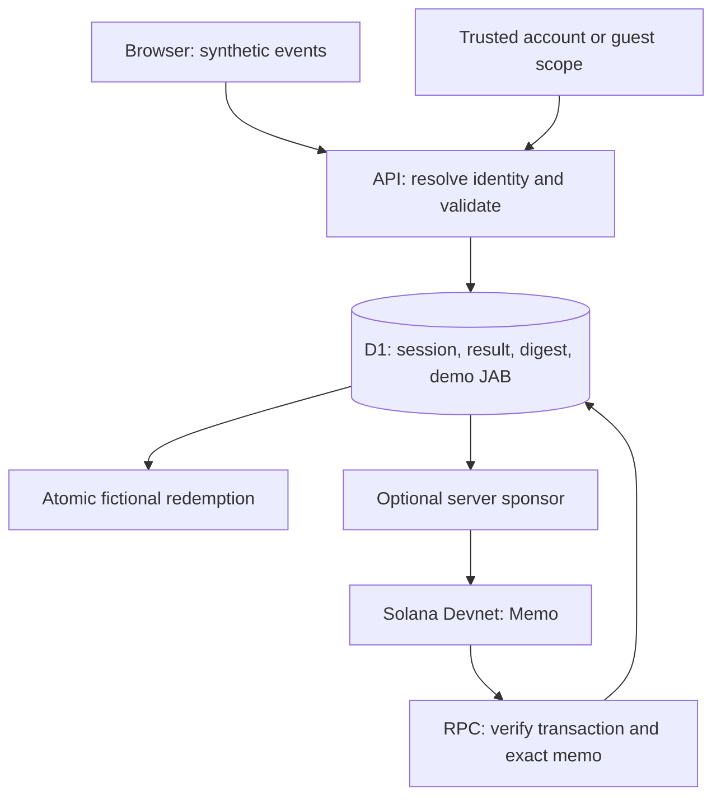
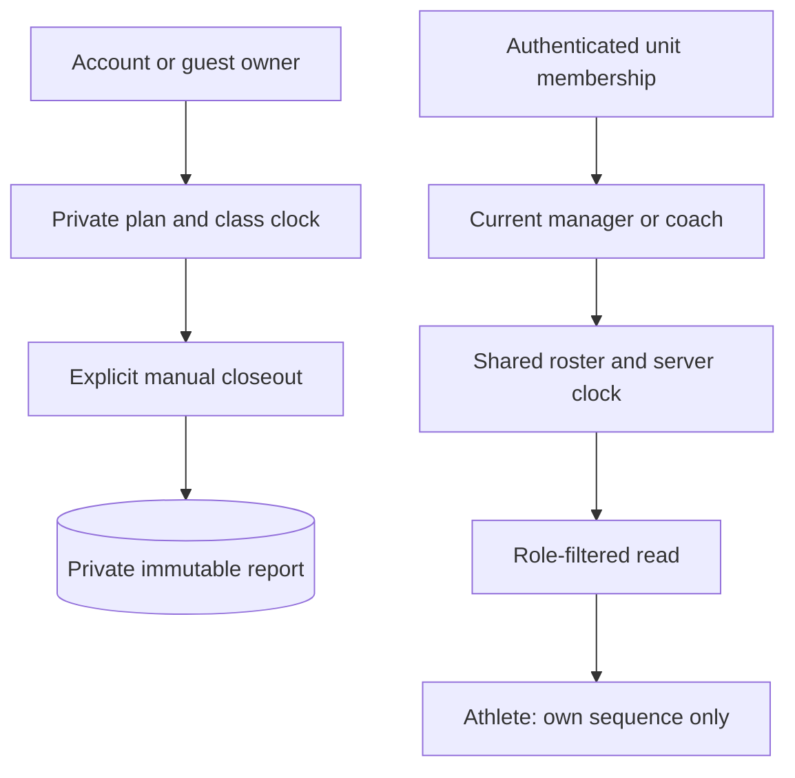
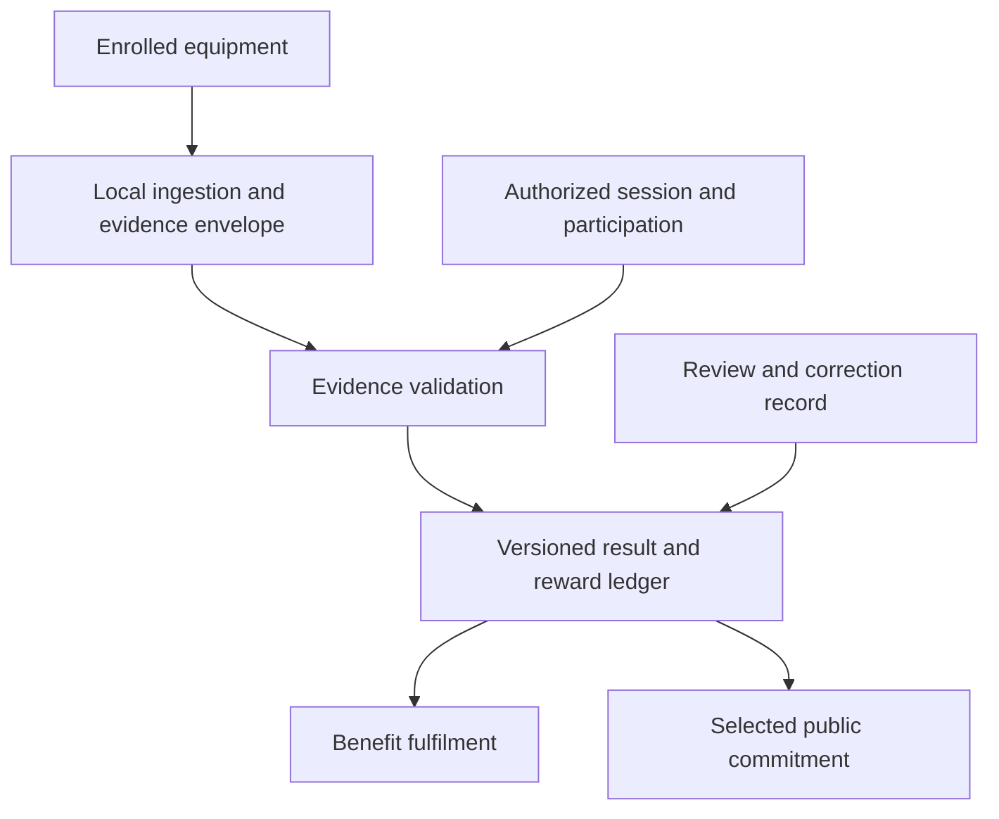

# Public architecture

This document separates **implemented behavior** from the **proposed production design**. Proof of Effort is the product direction; the current implementation is a bounded demonstration using explicitly synthetic events.

## 1. Implemented session pipeline

The browser is an untrusted producer of demo inputs. The API validates schema, round associations, event IDs, timestamps and numeric bounds, then calculates the illustrative result itself. It does not accept a client reward or balance. Only validated sessions reach the conditional D1 insert.

One credited session row is permitted per **server-resolved scope and session ID**. An identical retry returns the original saved result. Changed input under that ID conflicts. A distinct guest scope can submit the same ID independently; this is scoped credit deduplication, not a global identity or physical antifraud system.

Balances are derived from persisted session rewards minus redemption costs. Conditional redemption writes prevent a duplicate benefit or overdrawing that balance. JAB remains a database value with no monetary value.

### Contracts and authority

| Boundary / source | Input | Output | Authority and persistence |
|---|---|---|---|
| `lib/effort.ts` | Session ID and seed | Explicitly synthetic `SessionInput` | Pure generator; browser output is untrusted |
| `lib/identity.ts` | Sites-dispatched identity or guest cookie | Internal scope and safe identity metadata | Server selects ownership; callers cannot choose it |
| `app/api/demo/route.ts` | Bounded JSON, `action: complete`, `input` | Saved input, result, hash, duplicate flag, balance | Server validator and atomic D1 write |
| Demo redemption in the same API | `action: redeem`, benefit ID | Saved redemption and resulting balance | Server owns costs, available balance and one-per-benefit rule |
| Receipt request in the same API | `action: anchor`, owned session ID | Persisted chain status and optional signature | Uses saved digest; accepts no arbitrary client hash |
| `lib/solana.ts` | Saved session ID/hash | Exact Memo transaction and verified status | Server-only signer; Devnet RPC supplies chain evidence |

Session input contains `sessionId`, `source: simulator`, twelve `rounds` and bounded `events`. Events contain identifiers, station/round associations, relative timestamps and synthetic accuracy/intensity. The full public demo contract and formula are in [Implementation](IMPLEMENTATION.md); authoritative types and executable rules live in [effort.ts](../lib/effort.ts).

### Off-chain and on-chain

| Off-chain in D1 | Optional public Devnet Memo |
|---|---|
| Profile name/avatar; input telemetry; result; digest; fictional rewards/redemptions | `STRIKEX_DEMO_V1\|<sessionId>\|<sha256 hash>\|synthetic` |
| Class plans/runs, unit membership, role access, private reports | No profile name, raw telemetry, unit roster or JAB balance |

The digest is a commitment to a particular serialized declaration. The server persists a candidate signature before broadcast and verifies a successful transaction with the expected signature and exact Memo before reporting `confirmed`. A timeout may remain `pending`; unavailable funding/RPC must remain visible. A digest match establishes integrity relative to that digest, not athlete identity, physical effort or issuer authenticity. See [Solana](SOLANA.md).

### Two checksum formats, intentionally preserved

Individual session receipts hash the **legacy ordered JSON serialization** of `{sessionId, source, rulesVersion, rounds, events, result}` using UTF-8 SHA-256. Nested property ordering is part of those saved bytes. Historical results and rule versions must not be recalculated under current rules to reproduce that hash. Old rows without stored input cannot be independently reproduced. `lib/session-receipt.ts` provides the shared serialization, hashing and verification contract for the API and interface.

Private class reports instead hash their payload using **recursively sorted object keys**, preserving array order. These formats are different contracts. A session digest must never be checked using report canonicalization, and neither checksum is a digital signature. See the exact algorithms in [Implementation](IMPLEMENTATION.md).

## 2. Class operations are a separate data path

These paths do **not** feed the individual JAB ledger or the Devnet receipt flow.

| Module | Who can act | What it produces |
|---|---|---|
| `lib/class-planner.ts`, `/api/classes` | Current account/guest owner | Private, saved 12-round demonstration plan |
| `lib/class-run.ts`, `/api/class-runs` | That private plan/run's owner | Persistent clock with revision-checked commands |
| `lib/class-report.ts`, `/api/class-reports` | That terminal run's owner | Explicit `demo_declared` participation snapshot and checksum |
| `lib/units.ts`, `/api/units` | Signed-in accounts; manager controls invitations and roles | Test unit, stable memberships, hashed single-use invitations |
| `lib/unit-classes.ts`, `/api/unit-classes` | Current manager/coach controls; selected active athletes read their own sequence | Shared account-linked roster snapshot and server clock |

The independent demo planner enforces capacity **3 / 3 / 2 / 1 / 1 / 1**, optional per-athlete station exclusions and no consecutive repetition. It does not require every athlete to visit every station. It is not the production Solver and does not implement its full history, category or protection rules.

Command revisions reject competing stale writes. Server time determines elapsed state; the browser projects it for display and resynchronizes. The end of a clock is not attendance. Private closeout declarations use local roster labels, not account attestations. Shared unit classes have account-linked rosters but no authorized participation closeout yet.

## 3. Trust and privacy boundaries

- **Account identity:** trusted Sites dispatch resolves the identity server-side. Independent hosting needs its own trusted adapter. A display name is not verified physical identity.
- **Guest scope:** random HttpOnly, Secure, SameSite cookie; separate from account scope. Clearing the cookie loses access. Guest mode is not Sybil-resistant.
- **Unit authority:** manager/coach/athlete access is rechecked on the server. Sensitive class mutations also enforce role/roster eligibility in the write predicate. Role changes apply to subsequent requests.
- **Disclosure:** managers/coaches see authorized rosters; athlete responses omit other athletes' names, sequences and internal account scopes. Class titles are shared with selected athletes and should be neutral.
- **Signer:** the current ephemeral Devnet sponsor belongs to the server isolate. It is not a production key-management or custody design.
- **UI lab:** valid/invalid timing scenarios run the public validator locally without saving or crediting. Replaying a saved session calls the API and tests server deduplication.

## 4. Proposed production architecture — not deployed

The intended production flow connects an authorized athlete/session to enrolled equipment, validates evidence before any reward decision, and publishes only a selected public commitment. The following is a design boundary, not a claim of implemented hardware or settlement.

Proposed public contracts can expose version, opaque session/device references, challenge association, evidence digest, validation status and decision reference. Exact schemas require threat-model and privacy review before implementation. Raw sensor streams, device keys and private scoring internals need not become public chain data.

Production Solver integration should sit behind an allocation contract: bounded participants and constraints in; assignments, version and outcome out. Firmware, calibration and proprietary allocation/scoring internals remain behind their respective boundaries. Public contract tests should verify invariants without exposing those implementations.

The next accepted increment is account-linked participation closeout, followed by operational reliability, evidence ingestion and reward policy gates. Each has measurable acceptance in [Roadmap](ROADMAP.md). No real reward should depend on a synthetic event or a clock merely reaching zero.
