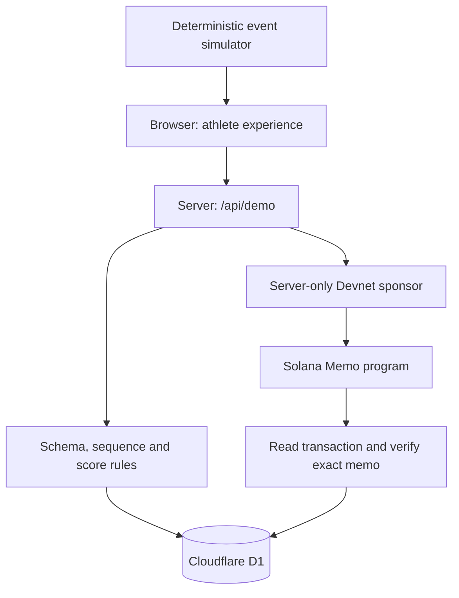

# StrikeX Proof of Effort — demonstrator architecture

This web prototype demonstrates synthetic training data → validation → points → benefit redemption → an optional Solana Devnet receipt. It is not a production fitness assessment, a hardware attestation system, a token issuance platform, or proof that physical exercise occurred.

## Components and authority

- `lib/effort.ts` is a pure TypeScript module shared by the replay and server. Server validation is authoritative: no submitted client score or reward is accepted.
- `app/api/demo/route.ts` is the application boundary. It parses bounded JSON, validates actions, scopes reads and writes to the guest cookie, and persists results.
- D1 holds profiles, completed sessions and redemptions. Balances are derived from recorded rewards minus recorded redemption costs, not browser storage.
- `lib/solana.ts` constructs, signs and submits a legacy Memo transaction using server Web Crypto. It verifies the transaction's successful execution and exact Memo content before returning `confirmed`.
- The browser provides the replay, results, history and technical explanation. The replay is synthetic and does not capture camera, sensor or biometric data.

## Guest identity

An HTTP-only, Secure, SameSite=Lax cookie holds a generated UUID. It is a bearer identifier for an isolated demo workspace, not an authenticated account or a wallet. Display name/avatar are demo profile data. Explicit cross-origin POSTs are rejected; JSON is required. Real authentication, account recovery and identity verification are outside this scope.

Reset deletes only the current guest's profile, sessions and redemptions, using a D1 batch, then rotates the guest identifier. It cannot remove a previously submitted public Devnet transaction. Losing the cookie loses access to that workspace through this UI.

## Data contracts

`SessionInput` contains exactly `sessionId`, `source`, `rounds` and `events`. Source must equal `simulator`. The API restricts session IDs to 8–100 alphanumeric, underscore or hyphen characters.

Every round contains `id`, `station`, `startMs`, `endMs`. IDs run 1–12. Six stations appear in fixed order twice: volume, technique, power, speed, VR and reflex. Each synthetic round lasts 6,000 milliseconds; the complete replay lasts 72 seconds. This is a fixed demonstration BOD, not the production class solver.

Every event contains `id`, `sessionId`, `roundId`, `station`, `timestampMs`, `accuracy` and `intensity`. Accuracy and intensity are synthetic values in [0,1]. IDs must be unique within the session; session/station/round associations must agree; integer timestamps must strictly increase and fall inside half-open round windows `[startMs, endMs)`. Each round requires at least one event. The request permits 12–2,400 events. Missing/unknown fields and nonfinite numeric values are rejected.

`SessionResult` contains `valid`, `errors`, `score`, `reward`, normalized `rounds`, `metrics` and `rulesVersion`. Invalid inputs yield zero score and reward. Intensity is validated and available for replay but is not used in this version's score.

## Demonstrative scoring

For validated events:

- `accuracy = round(100 × mean(event.accuracy))`
- `consistency = round(100 × minimum round event count / maximum round event count)`
- `volumeScore = min(100, 100 × event count / 96)`
- `score = round(0.5 × accuracy + 0.3 × consistency + 0.2 × volumeScore)`
- `reward = floor(score / 5)`

`metrics.volume` and `metrics.events` both contain the event count. Consistency measures distribution of synthetic events across rounds; it is not a measurement of movement quality. These weights are transparent and uncalibrated. They do not define the production STRIKE score.

## Persistence and concurrency

| Table | Key | Stored content |
|---|---|---|
| `demo_profiles` | `id` | Name, avatar, creation time |
| `demo_sessions` | `(guest_id, id)` | Input event stream JSON, result JSON, SHA-256 hash, reward, creation time, chain state, signature, error and lock time |
| `demo_redemptions` | `(guest_id, benefit)` | Cost and creation time |

The complete validated input event stream, result and hash are persisted in D1. The API returns `input: SessionInput | null` with each session so a receipt can be reproduced after page reload. The nullable input column was added by migration `0001`; older rows can lack a preimage and must not be presented as independently reproducible. The hash covers `JSON.stringify({sessionId: input.sessionId, source: 'simulator', rulesVersion: result.rulesVersion, rounds: input.rounds, events: input.events, result})`, encoded as UTF-8 and hashed with SHA-256. Preserve this property order when reproducing the digest. It binds that particular serialized declaration, not a physical athlete.

Completion uses one `INSERT OR IGNORE ... SELECT` statement with a 30-session-per-guest cap. The composite primary key guarantees only one credited row for a session within that guest. Replaying identical input returns the existing result; reusing the ID with another hash returns a conflict. Separate guests can use the same session ID independently.

Redemption uses one conditional insert whose balance condition and write execute together. The composite benefit key permits one redemption of each benefit per guest. Parallel requests cannot create a second redemption or overdraw the recorded balance. Current fictional benefits cost 10 and 25 demo JAB. Demo JAB are database points with no monetary value; there is no SPL token mint.

## API actions

| Action | Behavior |
|---|---|
| `GET /api/demo` | Current guest profile, recent sessions, redemptions and derived balance |
| `profile` | Create/update display name and avatar |
| `complete` | Validate synthetic input, compute result/hash and credit once |
| `redeem` | Redeem one supported fictional benefit if balance allows |
| `anchor` | Submit or recheck the Devnet receipt of an existing guest-owned session |
| `reset` | Delete current guest's stored demo state and rotate identifier |

## Devnet receipt lifecycle

`not_submitted` → `anchoring` → `confirmed`, `pending` or `unavailable`.

The anchor acquires a compare-and-swap lock against the observed chain status, signature and anchor timestamp. Confirmed rows cannot be relocked. Active locks have a 60-second stale threshold. This prevents concurrent requests using an old snapshot from independently submitting the same receipt after another request has updated it.

The Memo contains `STRIKEX_DEMO_V1|sessionId|sha256|synthetic`. It carries no display name. It is public if submitted. The sponsor is an ephemeral server-side Ed25519 key, funded through the Devnet faucet. It holds no mainnet funds and requires no user wallet connection.

Before broadcast, the candidate signature is saved through `onPrepared`. Requests with an existing signature verify that transaction instead of generating a new one. A signature alone is not confirmation: verification requires successful transaction metadata and an exact match for the Memo program and content.

Devnet may be unavailable or faucet-limited. Pending and unavailable states remain explicit and never become fabricated Explorer success. A persisted candidate that was never broadcast or expired can remain pending on subsequent verification; this minimal version has no automatic rebroadcast/replacement queue. Ephemeral sponsor funding and this recovery path should be replaced before production use.

## Verification and limits

`node --test tests/effort.test.ts` exercises malformed inputs, round/event inconsistencies, timing, duplicate events, numeric boundaries, deterministic generation and score bounds.

`python3 tests/db_invariants.py` loads the exact generated migration and extracts SQL statements from the API. It exercises concurrent replay, conflicting hashes, duplicate/competing redemptions, insufficient funds, guest isolation, the 30-session cap and the anchor compare-and-swap. These tests establish SQLite storage invariants. They do not prove deployment bindings, browser cookie behavior, public RPC availability, successful funding, or a completed on-chain transaction.

A deployed acceptance check must create two separate guest contexts, complete/replay a session, redeem a benefit, verify isolated history and inspect a genuine confirmed Devnet transaction if RPC/funding is available. Report pending/unavailable honestly when it is not. A successful build is not an on-chain integration test.

## Next steps toward physical Proof of Effort

Replace the simulator with versioned sensor event ingestion; define device enrollment and revocation; sign device/session payloads; tie timestamps to server-issued session challenges; enforce replay protection across devices and session ownership; validate calibration and impossible-pattern detection with labeled physical data. Train and validate any athletic scoring separately from transaction submission. Add authenticated accounts, durable signer management, queue-based confirmation/recovery, abuse controls, observability and privacy/retention rules before real rewards are introduced.

Blockchain can attest to publication of a result. Authenticating the physical effort remains an upstream hardware, identity and validation problem.
