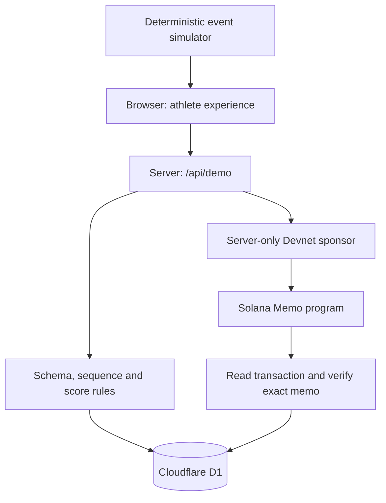

# StrikeX Proof of Effort — demonstrator architecture

This web prototype demonstrates synthetic training data → validation → points → benefit redemption → an optional Solana Devnet receipt. It is not a production fitness assessment, a hardware attestation system, a token issuance platform, or proof that physical exercise occurred.

## Components and authority

- `lib/effort.ts` is a pure TypeScript module shared by the replay and server. Server validation is authoritative: no submitted client score or reward is accepted.
- `app/api/demo/route.ts` is the application boundary. It parses bounded JSON, validates actions, scopes every read and write to the server-resolved account or guest identity, and persists results.
- D1 holds profiles, completed sessions and redemptions. Balances are derived from recorded rewards minus recorded redemption costs, not browser storage.
- `lib/solana.ts` constructs, signs and submits a legacy Memo transaction using server Web Crypto. It verifies the transaction's successful execution and exact Memo content before returning `confirmed`.
- The browser provides the replay, results, history and technical explanation. The replay is synthetic and does not capture camera, sensor or biometric data.

## Account and guest identity

Sites dispatch owns sign-in and sign-out. `getChatGPTUser()` reads the trusted per-Site identity on the server. `lib/identity.ts` maps it to `account:SHA256(userId)`, independent of browser cookies. Never accept account ownership from request JSON or user-supplied cookie contents. On independent hosting this dispatch trust boundary must be implemented before enabling account mode; exposing the Worker directly with trusted-header auth would be unsafe.

The guest cookie remains a separate HTTP-only, Secure, SameSite=Lax UUID. Entering or leaving an account preserves guest access without importing guest sessions or credits. The signed-in account starts with its own profile. The API returns only identity mode, optional display name, and the native top-level sign-in/out URLs. It does not return the account scope or email. GET is non-cacheable.

Profile names require 1–32 Unicode code points without control characters; avatars are restricted to 01–04. Reset deletes only the current scope's demo profile, sessions and redemptions in a D1 batch, preserving login and the guest cookie. It cannot remove public Devnet records. No coach roles, arena memberships or physical identity checks exist in this stage.

## Data contracts

`SessionInput` contains exactly `sessionId`, `source`, `rounds` and `events`. Source must equal `simulator`. The API restricts session IDs to 8–100 alphanumeric, underscore or hyphen characters.

Every round contains `id`, `station`, `startMs`, `endMs`. IDs run 1–12. Allowed station types are volume, technique, power, speed, VR and reflex. Consecutive rounds cannot use the same station; neither station coverage nor a specific cyclic order is required. Each synthetic round lasts 6,000 milliseconds; the complete replay lasts 72 seconds. The generator supplies a non-uniform illustrative journey. The full-class production Solver is not connected; this individual payload cannot validate class capacity. Rules version is `demo-1.1.0`.

Every event contains `id`, `sessionId`, `roundId`, `station`, `timestampMs`, `accuracy` and `intensity`. Accuracy and intensity are synthetic values in [0,1]. IDs must be unique within the session; session/station/round associations must agree; integer timestamps must strictly increase and fall inside half-open round windows `[startMs, endMs)`. Each round requires at least one event. The request permits 12–2,400 events. Missing/unknown fields and nonfinite numeric values are rejected.

`SessionResult` contains `valid`, `errors`, `score`, `reward`, normalized `rounds`, `metrics` and `rulesVersion`. Invalid inputs yield zero score and reward. Intensity is validated and available for replay but is not used in this version's score.

## Demonstrative scoring

For validated events:

- `accuracy = round(100 × mean(event.accuracy))`
- `consistency = round(100 × minimum round event count / maximum round event count)`
- `volumeScore = min(100, 100 × event count / 96)`
- `score = round(0.5 × accuracy + 0.3 × consistency + 0.2 × volumeScore)`
- `reward = floor(score / 5)`

`metrics.volume` and `metrics.events` both contain the event count. Consistency measures distribution of synthetic events across rounds; it is not a measurement of movement quality. These weights are transparent and uncalibrated. They do not define the production STRIKE score.

## Persistence and concurrency

| Table | Key | Stored content |
|---|---|---|
| `demo_profiles` | `id` | Name, avatar, creation time |
| `demo_sessions` | `(guest_id, id)` | Input event stream JSON, result JSON, SHA-256 hash, reward, creation time, chain state, signature, error and lock time |
| `demo_redemptions` | `(guest_id, benefit)` | Cost and creation time |

The complete validated input event stream, result and hash are persisted in D1. The API returns `input: SessionInput | null` with each session so a receipt can be reproduced after page reload. The nullable input column was added by migration `0001`; older rows can lack a preimage and must not be presented as independently reproducible. The hash covers `JSON.stringify({sessionId: input.sessionId, source: 'simulator', rulesVersion: result.rulesVersion, rounds: input.rounds, events: input.events, result})`, encoded as UTF-8 and hashed with SHA-256. Preserve this property order when reproducing the digest. It binds that particular serialized declaration, not a physical athlete.

Completion uses one `INSERT OR IGNORE ... SELECT` statement with a 30-session-per-guest cap. The composite primary key guarantees only one credited row for a session within that guest. Replaying canonically identical saved input returns the original result, hash and rules version before applying current rules. Changed input under the same ID returns a conflict. Existing stored inputs are immutable; a rules update never rewrites a historical receipt. Separate guests can use the same session ID independently.

Redemption uses one conditional insert whose balance condition and write execute together. The composite benefit key permits one redemption of each benefit per guest. Parallel requests cannot create a second redemption or overdraw the recorded balance. Current fictional benefits cost 10 and 25 demo JAB. Demo JAB are database points with no monetary value; there is no SPL token mint.

## API actions

| Action | Behavior |
|---|---|
| `GET /api/demo` | Current account/guest profile, recent sessions, redemptions, derived balance and identity descriptor |
| `profile` | Create/update display name and avatar |
| `complete` | Validate synthetic input, compute result/hash and credit once |
| `redeem` | Redeem one supported fictional benefit if balance allows |
| `anchor` | Submit or recheck the Devnet receipt of an existing session owned by the current scope |
| `reset` | Delete the current scope's stored demo state, preserving account sign-in and guest cookie |

## Devnet receipt lifecycle

`not_submitted` → `anchoring` → `confirmed`, `pending` or `unavailable`.

The anchor acquires a compare-and-swap lock against the observed chain status, signature and anchor timestamp. Confirmed rows cannot be relocked. Active locks have a 60-second stale threshold. This prevents concurrent requests using an old snapshot from independently submitting the same receipt after another request has updated it.

The Memo contains `STRIKEX_DEMO_V1|sessionId|sha256|synthetic`. It carries no display name. It is public if submitted. The sponsor is an ephemeral server-side Ed25519 key, funded through the Devnet faucet. It holds no mainnet funds and requires no user wallet connection.

Before broadcast, the candidate signature is saved through `onPrepared`. Requests with an existing signature verify that transaction instead of generating a new one. A signature alone is not confirmation: verification requires successful transaction metadata and an exact match for the Memo program and content.

Devnet may be unavailable or faucet-limited. Pending and unavailable states remain explicit and never become fabricated Explorer success. A persisted candidate that was never broadcast or expired can remain pending on subsequent verification; this minimal version has no automatic rebroadcast/replacement queue. Ephemeral sponsor funding and this recovery path should be replaced before production use.

## Verification and limits

`node --test tests/effort.test.ts` exercises malformed inputs, round/event inconsistencies, timing, duplicate events, numeric boundaries, deterministic generation and score bounds.

`python3 tests/db_invariants.py` loads the exact generated migration and extracts SQL statements from the API. It exercises concurrent replay, conflicting hashes, duplicate/competing redemptions, insufficient funds, guest isolation, the 30-session cap and the anchor compare-and-swap. These tests establish SQLite storage invariants. They do not prove deployment bindings, browser cookie behavior, public RPC availability, successful funding, or a completed on-chain transaction.

A deployed acceptance check must create two separate guest contexts, complete/replay a session, redeem a benefit, verify isolated history and inspect a genuine confirmed Devnet transaction if RPC/funding is available. Report pending/unavailable honestly when it is not. A successful build is not an on-chain integration test.

## Next steps toward physical Proof of Effort

Replace the simulator with versioned sensor event ingestion; define device enrollment and revocation; sign device/session payloads; tie timestamps to server-issued session challenges; enforce replay protection across devices and session ownership; validate calibration and impossible-pattern detection with labeled physical data. Train and validate any athletic scoring separately from transaction submission. Add coach authorization, class membership, durable signer management, queue-based confirmation/recovery, abuse controls, observability and privacy/retention rules before real rewards are introduced.

Blockchain can attest to publication of a result. Authenticating the physical effort remains an upstream hardware, identity and validation problem.

Stage 1 verification adds identity isolation, cookie spoof rejection, profile bounds and actual route-handler tests with mocked trusted identity. Browser sign-in and cross-device UX require the user acceptance pass; unit tests do not establish a completed provider login.

## Stage 2: class planning

`POST /api/classes` validates a bounded 1–11-athlete roster and optional station exclusions, generates a complete 12-round matrix on the server, and persists it in `demo_class_plans` before returning. Scope comes from the same server identity resolver as the athlete demo. Fixed capacities are 3/3/2/1/1/1. No mandatory all-station coverage. A saved plan is a demonstration allocation, not a workout receipt.

The composite `(scope_id,id)` primary key makes generation idempotent. Accepted raw input is compared canonically before current validation on retries, preserving historical plans. A conditional insert enforces 20 plans per scope atomically. Cross-scope reads and deletion are rejected; request JSON cannot choose ownership. Migration 0002 only adds the new table. Names are displayed as text and never enter a blockchain receipt through class planning.

Original production Solver code is not integrated. This independent demonstrator covers capacity, manual exclusions and no adjacent station repetition. Category restrictions, weekly novelty, recruit protection, shared coach authorization, booking and check-in remain future work. Stage 3 adds an owner-scoped demonstration clock below.

## Stage 3: class operation

`demo_class_runs` stores a scoped immutable plan/input/timing snapshot, revision, server clock state, active flag and the latest command receipt. A partial unique index on scope where active=1 permits only one ready/running/paused run. The insertion enforces a 20-record cap atomically. GET and mutations materialize elapsed completion with revision CAS; no background job is required for elapsed time to remain correct.

`lib/class-run.ts` projects 12 work periods and 11 rests from persisted elapsedMs/startedAt. Start/pause/resume/interrupt only accept valid transitions. The API rejects client timestamps, state, elapsed values, ownership and unknown fields. Input rounds last 5–300 seconds and rests 0–120 whole seconds. Ended classes cannot revive. Delete requires ownership, terminal state and the observed revision.

Creation request IDs replay identical input even after the run has progressed. Latest-command retries with the same canonical payload return current state; older retries receive a stale-revision conflict. This is bounded retry protection, not an audit log of every command.

The React panel synchronizes every three seconds, anchors display projection to serverNow plus a monotonic browser clock, and rejects superseded reads after mutations. It flags failed/old synchronization and disables commands until recovery. Display time may lag by network latency; server commands and persisted state are authoritative. Browser suspension/reload is repaired by the next synchronization.

No shared gym coach role is granted: authorization is ownership under existing account/guest identity. Timing completion does not produce physical proof, athlete participation, telemetry or JAB. The independent athlete replay remains a separate demonstration.

Stage 3 verification includes pure clock boundaries, actual route handlers backed by migrated SQLite and separate concurrent SQLite invariants. Full suite: 53 TypeScript + 20 SQLite tests. User visual acceptance covers navigation, responsive controls, timing display and browser reload behavior.
